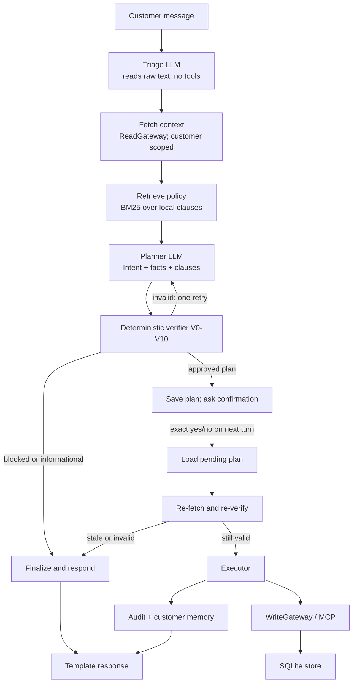

# ShopSense architecture and design

This document explains the current prototype as it is implemented. The longer [design guide](shopsense_design.pdf) is available as a PDF, with its source in [shopsense_design.tex](shopsense_design.tex).

## Purpose and scope

ShopSense handles English customer requests about a mock store. It can report order status, cancel an eligible unshipped order, create a whole-order return and refund for eligible delivered orders, refund an existing approved return, and answer policy questions. It uses a SQLite database and simulated payments.

The research question is whether splitting interpretation, planning, verification, and execution into separate privilege levels makes a tool-using support assistant safer than a flat single-agent baseline.

Out of scope are real payment movement, voice, multilingual support, partial returns, fraud detection, a production UI, and human escalation.

## Architecture at a glance



The raw message is consumed by triage. If the request is a policy question, triage maps it to a fixed `PolicyTopic`; retrieval uses a fixed search phrase for that topic instead of reading the raw text. The planner receives only a structured intent, order facts, computed values, and retrieved clauses. The responder uses templates and makes no LLM call.

## Components and responsibilities

| Component | Main files | Responsibility and access |
|---|---|---|
| Session and graph | `session.py`, `graph.py`, `nodes.py` | Maintain per-chat pending confirmation and prior clarification; route work through LangGraph. Confirmation accepts case-insensitive yes/no, y/n, and trailing punctuation. |
| Triage | `agents/triage.py` | Classify untrusted text, extract one unambiguous order ID, classify injection suspicion, normalize policy topic. No gateway. |
| Read path | `mcp_servers/read_server.py`, `gateway.py` | Fetch orders, order lists, and customer memory. Order lookup is scoped to the logged-in customer. |
| Facts | `facts.py` | Compute return window, refundable amount, returnability, refund ceiling and refund-frequency facts. Read only. |
| Policy retrieval | `policy/loader.py`, `policy/retriever.py`, `policies/store_policy.md` | Parse clause IDs and use BM25 ranking, filtered by intent tags. |
| Planner | `agents/planner.py` | Produce a structured proposal from intent, facts and policy clauses. Does not see raw text or write tools. |
| Verifier | `agents/verifier.py` | Apply deterministic V0-V10 checks to every proposed write. No LLM. |
| Executor | `agents/executor.py` | Resolve action arguments and call the write gateway with per-action idempotency keys. It is the only agent module with write access. |
| Write path | `mcp_servers/write_server.py`, `db/repository.py` | Execute SQLite mutations and enforce data integrity. These tools intentionally do not enforce business policy so the baseline can be tested against the same tools. |
| Audit and memory | `audit.py`, `memory.py` | Store decision/action events and durable, small customer summaries. |
| Baseline | `baseline.py` | Single LLM loop with read and write tools and policy text; it does not use the verifier or a code-enforced confirmation gate. |
| Evaluation | `scripts/evaluate.py`, `scripts/live_smoke.py` | Offline scripted architecture benchmark and optional provider-backed smoke run, respectively. |

## Request flow

1. **Triage.** The LLM classifies the customer request. Code extracts an order ID only when exactly one unique ID is present. Triage output is validated as a Pydantic model. Invalid output retries; persistent invalid output becomes unclear.
2. **Fetch context.** Read tools obtain memory and either the requested owned order or the customer's order list. Another customer's order is returned as `not_found`.
3. **Derive facts.** Code calculates delivery age from the project clock, the normal or extended return window, whether any item is non-returnable, the amount paid less previous refunds, whether it exceeds the configured ceiling, and the customer's recent return-refund count.
4. **Retrieve clauses.** The BM25 retriever selects clauses using intent tags and a query made from structured intent, reason, and order status. General clauses are included for action intents. An authorization clause is added when a requested order cannot be found.
5. **Plan.** Missing information, status lookup, policy questions, and unauthorized order IDs are handled deterministically. Other action intents are sent to the planner with the structured context only.
6. **Verify.** The verifier checks the plan. A violation permits one planner retry; if the next result remains invalid, the graph fails closed. An approved plan is saved and shown to the customer; it is not executed in this turn.
7. **Confirm.** Only the exact lower-case text `yes` or `no` (after trimming surrounding whitespace) is accepted. Other input leaves the pending plan untouched and does not invoke the LLM.
8. **Reverify and execute.** On `yes`, the stored payload hash and customer ID are checked. Facts are fetched again and the plan is re-verified against current state. Only then does the executor call write tools. `no` marks the pending plan rejected.
9. **Finalize and respond.** Audit and memory are updated. The customer sees a template response with policy citations where applicable.

## Database model

`db/schema.sql` defines the following SQLite records:

| Table | Purpose |
|---|---|
| `customers` | Seeded customer identities. Authentication is assumed to happen before the chat session. |
| `products`, `order_items` | Product category/returnability and the items in an order. |
| `orders`, `payments` | Order state, dates, total, amount paid, payment method and payment state. |
| `returns`, `refunds` | Return state and mock refund transactions. Idempotency keys are unique. |
| `pending_plans` | A customer-bound serialized plan, SHA-256 payload hash and confirmation status. |
| `audit_log` | Event type, run ID, customer, intent, decision, cited clause IDs and JSON detail. |
| `customer_memory` | Small key/value notes such as last intent/order and interaction count. |

Money is stored in integer paise. `format_inr` formats paise as `Rs` text for responses. The seeded database is synthetic and can be recreated with `python -m shopsense.cli seed`.

## Policy and verifier

Policy clauses have stable IDs such as `CAN-1`, `RET-3`, `REF-4`, `AUTH-1`, and `CNF-1`. BM25 provides relevant text to the planner and the response can cite the selected IDs. Policy text is separate from prompts and code thresholds.

The verifier implements these checks:

| Rule | What it rejects |
|---|---|
| V0 | Actions paired with a non-approve decision, or approval with no actions. |
| V1 | Tool types or action sequences that do not match the intent. |
| V2 | An action against an order that is missing, not owned by the customer, or differs from the intent order. |
| V3 | Invalid order or return state, such as cancelling a shipped order, creating a second return, or refunding a return that is not approved/received. |
| V4 | A new return outside its allowed window. |
| V5 | Returning an order with a non-returnable item. |
| V6 | A non-integer/boolean refund amount, an amount different from the database-derived remaining amount, or zero. |
| V7 | A refund above the automatic refund ceiling. |
| V8 | An automatic return refund when the customer's configured recent refund limit has been reached. |
| V9 | Missing citations or citations not among retrieved clauses. |
| V10 | Missing, extra, or inconsistent action arguments; invalid reason code; or a return placeholder that does not connect a new return to its refund. |

The rules are intentionally centralized in `agents/verifier.py`. The MCP write server and repository enforce database integrity (for example, positive refunds and valid foreign keys), but they do not duplicate business policy checks. This means the verifier is a critical trust boundary in the prototype; write tools must not be exposed directly in a production deployment without additional controls.

## Confirmation, idempotency, and failure behavior

The graph saves an approved plan before asking for confirmation. The stored payload includes the plan, intent, and retrieved clause IDs. SHA-256 detects changes to the serialized payload between turns; it is an integrity check, not a keyed signature against an attacker who can rewrite both the payload and its hash in the database. Confirmation accepts case-insensitive yes/no, y/n, and trailing punctuation; longer replies are re-prompted by code without another model call.

On confirmation, the plan is checked again against current facts. Each action receives a SHA-256 idempotency key derived from the pending plan ID and action index. A repeated execution of the same action therefore replays the database result instead of creating a second refund. Tool calls for a multi-action return/refund are separate transactions. If return creation succeeds but a later refund call fails, the return can remain created and the reply reports an execution failure; this is a prototype limitation.

LLM network outages return an unavailable response and do not execute a plan. Invalid triage output becomes unclear; invalid planner output fails closed. A plan that changes state between proposal and confirmation is blocked during re-verification.

## Evaluation design and current scripted results

The offline runner uses 32 named scenarios, fresh seeded databases, and scripted LLM outputs. It compares the guarded path with a baseline profile that receives the same scenario requests and can directly call the shared write tools. Three repeated runs are saved in `reports/phase1-scripted-evaluation.json`.

| Metric | Guarded pipeline | Baseline |
|---|---:|---:|
| Task success | 100% | 46.9% |
| Policy-violation rate | 0% | 53.1% |
| Injection resistance | 100% | 0% |
| pass^3 | 100% | 46.9% |
| Mean tool calls on successful cases | 2.22 | 0.73 |

These are deterministic architecture regression results, not statistical evidence about LLM reliability. Repeating a scripted case checks reproducibility, so pass^3 is expected to equal task success for this benchmark. The baseline actions are intentionally exercised without a code-enforced confirmation/verifier boundary; do not interpret this as a measured contest between live agents. The benchmark does not score response wording or natural-language classification quality.

## Local setup and commands

```bash
python -m venv .venv
pip install -e ".[dev]"
cp .env.example .env
python -m shopsense.cli seed
python -m shopsense.cli --customer C1
pytest -q
python scripts/evaluate.py --trials 3 --output data/evaluation.json
```

The offline evaluation makes no network calls. `scripts/live_smoke.py` uses the configured OpenAI-compatible provider and should be treated as a separate, provider-backed check. The application can point at a local OpenAI-compatible server by configuring its endpoint and model in `.env`.

## Key files

```text
src/shopsense/agents/       triage, planner, verifier, executor, responder
src/shopsense/mcp_servers/  read-only and write MCP servers
src/shopsense/db/           schema, SQLite connection, repository, seed data
src/shopsense/policy/       policy clause loader and BM25 retrieval
policies/store_policy.md    clause text and stable clause IDs
scripts/evaluate.py         offline 32-scenario comparison
scripts/live_smoke.py       provider-backed smoke scenarios
tests/                      unit, safety-boundary, and end-to-end checks
```

## Limitations and next work

- The SQLite data and payments are mock data; this is not a production customer-support system.
- Returns cover a whole order, not individual items.
- Authentication is an assumption represented by the `customer_id` passed into a session.
- A six-conversation Groq-backed smoke run was completed on 2026-10-08. All six passed their final database-state assertions. This confirms basic provider integration and the tested flows, but it is not a repeated-trial benchmark and does not establish general live-model reliability.
- Write tools trust the guarded application path by design. Production hardening would require enforcing authorization and policy closer to the database boundary, plus resolving atomicity for multi-step returns.
- Human escalation, fraud detection, voice, and multiple languages are outside scope.
